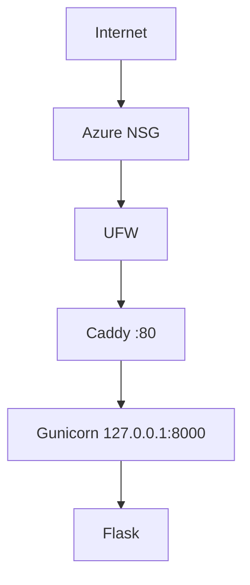

# Architecture v0.1

## Deployment View

## Resource Constraints
- 2 vCPU
- 891 MiB RAM
- 62 GB disk
- Ubuntu Server 24.04.5 LTS, Python 3.12.3

## Security Decisions
- non-root administration (user cloudstudent)
- SSH key authentication (Ed25519)
- password SSH disabled, root login disabled
- UFW enabled, hanya port 22 dan 80
- backend loopback-only (127.0.0.1:8000)

## Current Limitations
- HTTP only
- single VPS
- no database
- no container
- no CI/CD

## Planned Evolution
- M04 DNS + HTTPS
- M05 persistent data
- M06 container
- M07 IaC
- M09 CI/CD
